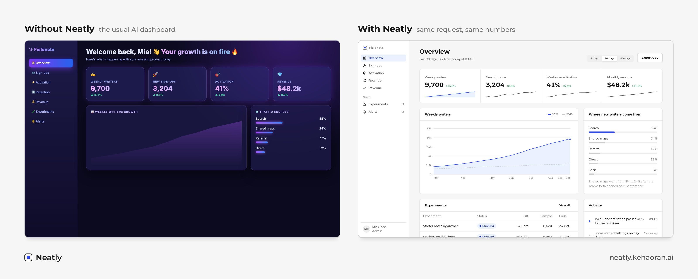
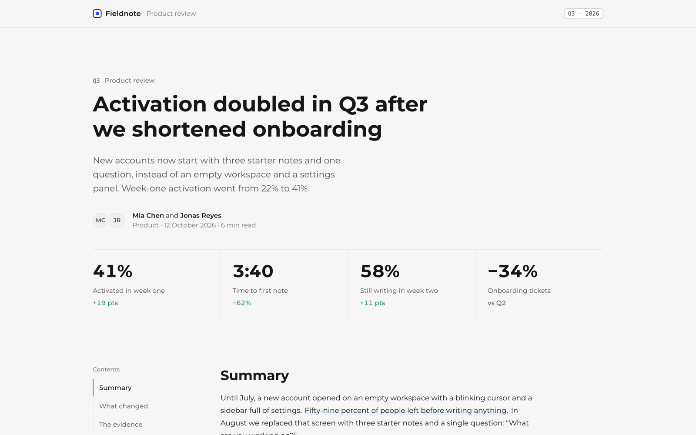
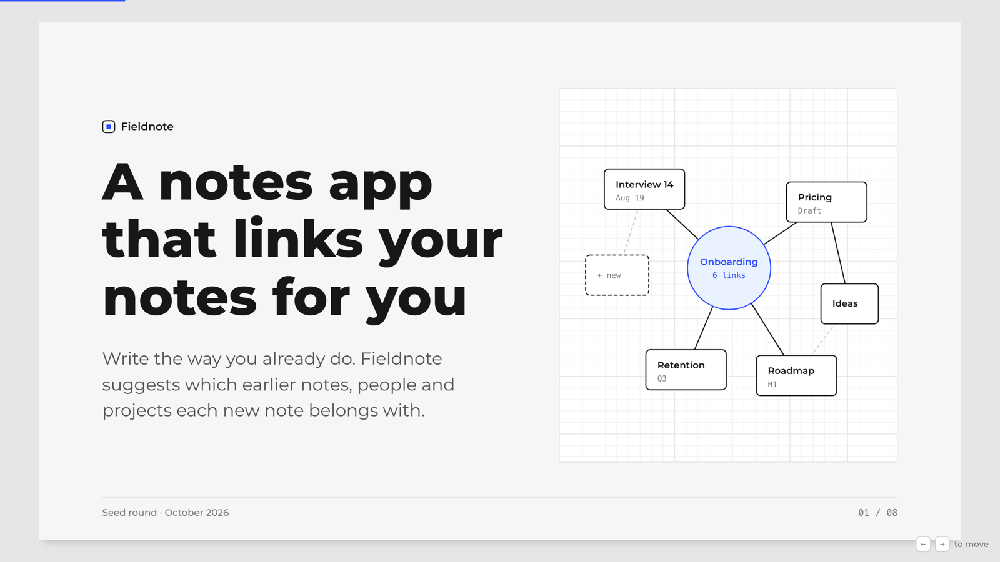
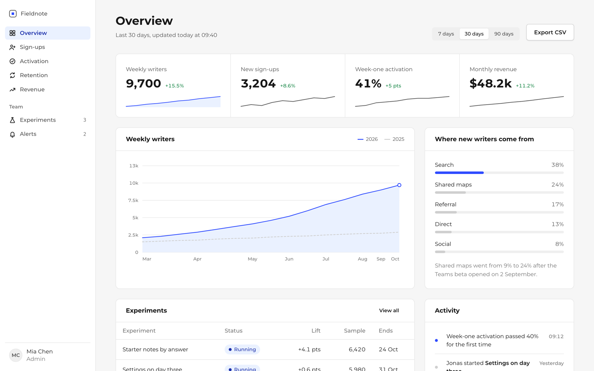
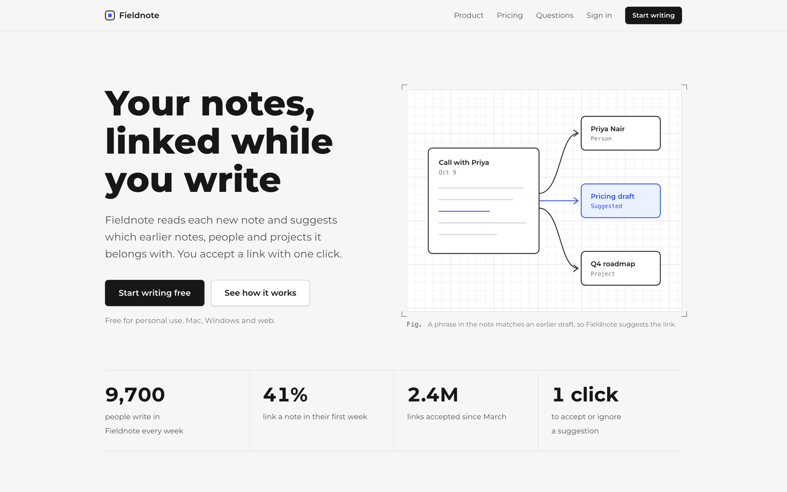
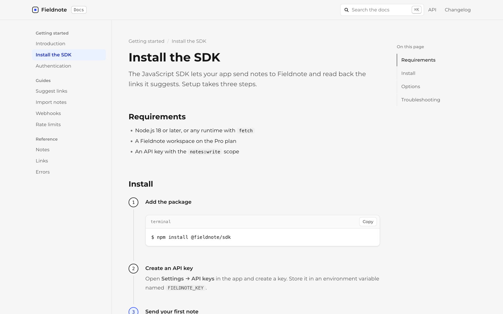

<div align="center">

# Neatly

**HTML pages from your AI that look like a person designed them.**

A skill for Claude Code, Codex, Cursor and any agent that reads skills.<br>
Reports, slide decks, dashboards, landing pages and docs, in one calm visual system.

[Live demo](https://neatly.kehaoran.ai) · [Examples](#five-layouts-one-look) · [Install](#install) · [简体中文](README.zh-CN.md)

[](LICENSE)
[](#install)
[](#install)
[](#no-agent-no-problem)

</div>



```bash
npx skills add kehaoran-ai/neatly
```

Then ask your agent for a page the way you normally would. That is the whole setup.

## You can spot an AI-made page in a second

Ask any model for an HTML report and you get the same page everyone gets: a purple-to-blue gradient, a glowing headline with a rocket emoji, three cards in a row, an all-caps badge, and copy about "unlocking seamless growth". It is not ugly by accident. With no design system to work inside, the model falls back on the average of every landing page it has seen.

Neatly gives it a system instead:

- **One look.** Neutral greys, one sans typeface, line-art diagrams on graph paper, and a single accent colour that you can change in one line.
- **Five layouts to start from**, so the agent writes content instead of inventing structure.
- **Writing rules.** Headlines state the finding with a number. No slogans, no stock phrases, nothing the user did not say.
- **A checker** that fails the page for the usual tells before you ever see it.

## Five layouts, one look

Every example below is a single HTML file. Click through to the live page.

| | |
|---|---|
| [](https://neatly.kehaoran.ai/examples/report.html)<br>**[Report](https://neatly.kehaoran.ai/examples/report.html)**: reviews, analyses, memos and research write-ups | [](https://neatly.kehaoran.ai/examples/deck.html)<br>**[Deck](https://neatly.kehaoran.ai/examples/deck.html)**: 16:9 slides, arrow keys to move, prints to PDF |
| [](https://neatly.kehaoran.ai/examples/dashboard.html)<br>**[Dashboard](https://neatly.kehaoran.ai/examples/dashboard.html)**: KPIs with sparklines, charts, tables, activity | [](https://neatly.kehaoran.ai/examples/landing.html)<br>**[Landing page](https://neatly.kehaoran.ai/examples/landing.html)**: hero, features, pricing, FAQ, closing call |
| [](https://neatly.kehaoran.ai/examples/docs.html)<br>**[Docs](https://neatly.kehaoran.ai/examples/docs.html)**: guides and API pages with steps and copyable code | **Try a different colour.** The [demo site](https://neatly.kehaoran.ai) recolours every example live, and shows the starting file behind each one. |

All five work at desktop, tablet and phone widths, and print cleanly.

## How a page gets made

1. **You ask in plain words.** "Make an HTML report on our September sales: revenue 18,400 dollars, up 12%." The skill picks the layout.
2. **The agent writes only the body.** `make.py` copies the design system in untouched, so the agent writes about 80 lines of content, not 800 lines of CSS.
3. **The checker reads the page.** Errors are fixed before the page is handed over.
4. **The page opens.** One file. It works offline, fits phones and prints cleanly.

```text
$ python3 scripts/make.py report body.html september.html --title "September sales"
wrote september.html
ok  september.html  (0 errors, 0 warnings)
```

We tested this with fresh agents that had never seen Neatly. Given only the skill, they produced a passing report and a passing slide deck on the first try, in 6 to 8 tool calls each.

## Install

**Claude Code**

```
/plugin marketplace add kehaoran-ai/neatly
/plugin install neatly@neatly
```

**Any agent that reads skills** (Claude Code, Codex, Cursor and others)

```bash
npx skills add kehaoran-ai/neatly
```

**By hand**

```bash
git clone https://github.com/kehaoran-ai/neatly
cp -r neatly/skills/neatly ~/.claude/skills/
```

## Things to ask for

```
Turn these meeting notes into a 6-slide deck for Monday.
```

```
Make a dashboard of our signups, activation and revenue from this CSV.
```

```
Write the docs page for installing our CLI, with copyable commands.
```

```
Make this page look better.        (attach any existing HTML file)
```

## Make it yours

Everything follows one token. Put this at the top of the page's `<body>`:

```html
<style>:root { --nt-accent: #e4572e; }</style>
```

Or just ask: "use our brand colour #e4572e". To preview a colour on any Neatly page, add `?accent=e4572e` to its URL.

Chinese and Japanese pages work out of the box. The CJK system font sets the whole line, so Latin words inside a Chinese heading match the characters around them.

## The checker

```bash
python3 skills/neatly/scripts/check.py page.html
```

| Fails the page | Warns about |
|---|---|
| Serif or italic headlines, Inter and Geist | Raw colours that bypass the accent token |
| Gradients, glow, blur and glass | Heavy shadows |
| Coloured bars down the left of a block | Too many cards or too many accents |
| A row of exactly three cards | More than two em dashes |
| All-caps text, emoji, dark-mode styles | Stock phrases such as "seamless" and "unlock" |
| Leftover placeholders, a missing viewport | |

Run it on pages that were not made with Neatly too. It is a quick way to see why a page looks generated.

## No agent, no problem

`skills/neatly/neatly.css` works on its own. Copy a file from `skills/neatly/layouts/`, replace the `TODO`s and open it in a browser. `neatly.js` is optional: it draws the charts, runs the slides, and handles copy buttons and the contents highlight. Every class is listed in [`reference/components.md`](skills/neatly/reference/components.md).

## Questions

**Which agents does it work with?** Anything that loads skills: Claude Code as a plugin or a skill, and Codex, Cursor and others through `npx skills`. If your agent has no skills support, clone the repo and tell it to follow `skills/neatly/SKILL.md`.

**Does the page need the internet?** Only for the Montserrat font, and it falls back to system fonts offline. There are no other requests.

**Why not Tailwind or a component library?** The output has to be one file you can email, open by double-clicking, or drop into a chat. No build step, no CDN script, nothing to install.

**Can I change the font?** Set `--nt-sans` the same way as the accent. Keep it a sans; the checker fails serif headlines on purpose.

**Is there a dark mode?** No. One mode, done well, is the point.

## What is inside

```
skills/neatly/
  SKILL.md              how the agent uses Neatly
  neatly.css            the visual system, inlined into every page
  neatly.js             charts, slides, copy buttons, contents (optional)
  layouts/              five starting files
  reference/            component reference
  scripts/make.py       builds a page from a layout and a body
  scripts/check.py      the checker
examples/               the five finished pages
site/                   the demo site
```

Editing the CSS or JS? Run `python3 scripts/build.py` to inline them into every layout and example again.

## Contributing

Issues and pull requests are welcome, especially new AI tells for the checker and pages where a layout falls short. Please attach a screenshot.

## License

MIT, by [Ke Haoran](https://github.com/kehaoran-ai). If Neatly saved you from one purple gradient, a star helps other people find it.
