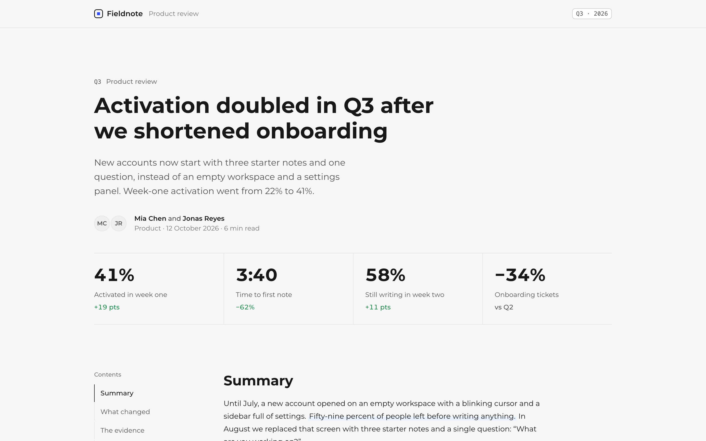
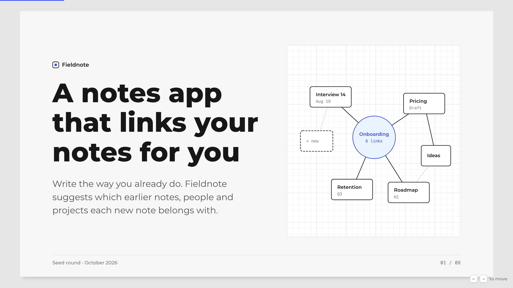
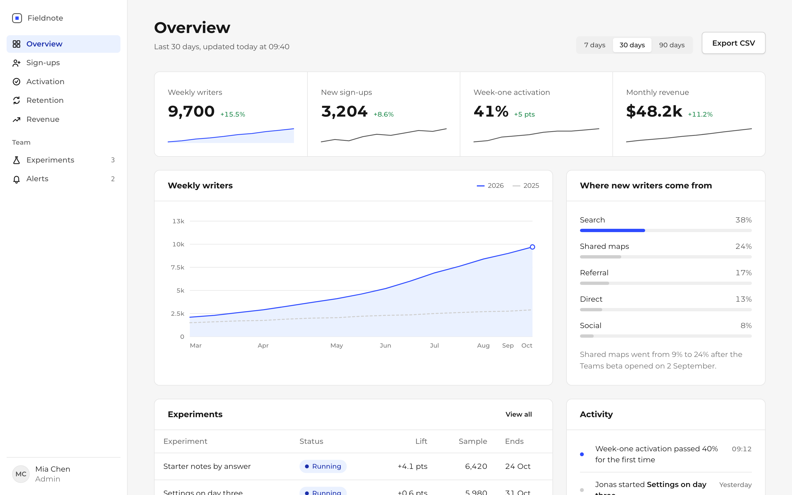
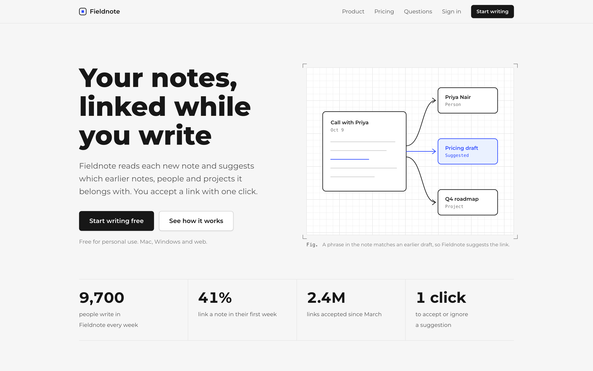
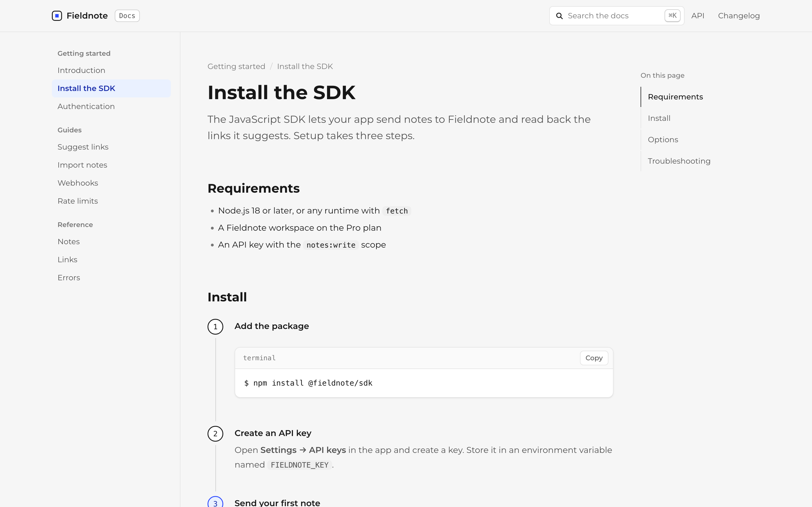

# Neatly

让 AI 做出来的 HTML 页面，看起来像设计师做的。

Neatly 是一个给 Claude Code 等 AI 编程工具用的 skill。让它做报告、路演幻灯片、数据看板、产品落地页或文档页，得到的是一个单文件 HTML：中性灰、只用一种无衬线字体、方格纸上的线稿图、只有一个主题色，主题色改一行就能换。

[English](README.md) · 简体中文



## 为什么做

让任何模型做一个 HTML 页面，一眼就能看出是 AI 做的：紫到蓝的渐变、发光的首屏、一排三张带 emoji 图标的卡片、衬线大标题里夹一个斜体词、全大写的小标签、「Unlock seamless productivity」。Neatly 给模型一套固定的视觉系统、五个起步版式、一套写作规矩，再加一个检查脚本，在页面交给你之前把这些毛病挑出来。

## 五个版式，一套风格

| 版式 | 用在 | 例子 |
|---|---|---|
| 报告 | 复盘、分析、备忘、调研总结 | [report.html](examples/report.html) |
| 幻灯片 | 路演和汇报，16:9，可直接打印成 PDF | [deck.html](examples/deck.html) |
| 数据看板 | 指标总览、状态页 | [dashboard.html](examples/dashboard.html) |
| 落地页 | 产品页、发布页 | [landing.html](examples/landing.html) |
| 文档 | 教程、安装说明、API 页 | [docs.html](examples/docs.html) |

| | |
|---|---|
|  |  |
|  |  |

每个例子都是一个单文件，下载后双击就能打开，不需要构建。

## 安装

**Claude Code**

```
/plugin marketplace add kehaoran-ai/neatly
/plugin install neatly@neatly
```

**其他支持 skill 的工具**（Claude Code、Codex、Cursor 等）

```bash
npx skills add kehaoran-ai/neatly
```

**手动安装**

```bash
git clone https://github.com/kehaoran-ai/neatly
cp -r neatly/skills/neatly ~/.claude/skills/
```

## 怎么用

直接说要什么，版式由 skill 自己选。

```
把我们 9 月的销售做成一份 HTML 报告：营收 18,400 美元，环比涨 12%，
取消加价后燕麦奶订单占比从 21% 涨到 34%。
```

```
把这些笔记做成 6 页的幻灯片，周一团队会用。
```

```
把这个页面改好看一点。（附上现有的 HTML 文件）
```

AI 会复制一个版式、写内容、跑检查脚本，然后打开页面。

## 换主题色

所有颜色都跟着一个变量走。在页面 `<body>` 的开头加一行：

```html
<style>:root { --nt-accent: #e4572e; }</style>
```

不想改文件，可以在任意页面的地址后面加 `?accent=e4572e` 先看效果。

## 检查脚本

```bash
python3 skills/neatly/scripts/check.py page.html
```

以下情况会判为不通过：衬线或斜体标题、Inter 和 Geist 字体、渐变、发光和毛玻璃、彩色左边条、一排正好三张卡片、全大写文字、emoji、深色模式样式、没替换的占位符、缺少 viewport。以下情况会给出提醒：写死的色值、过重的阴影、卡片或强调色用得太多、破折号太多，以及「seamless」「unlock」这类套话。

## 不用 AI 也能用

`skills/neatly/neatly.css` 可以单独使用：从 `skills/neatly/layouts/` 复制一个文件，替换掉里面的 `TODO`，然后打开。`neatly.js` 是可选的，负责画图表、翻幻灯片、代码复制按钮和目录高亮。所有类名见 [`reference/components.md`](skills/neatly/reference/components.md)。

## 目录

```
skills/neatly/
  SKILL.md              AI 怎么用 Neatly
  neatly.css            视觉系统，内联进每个页面
  neatly.js             图表、幻灯片、复制按钮、目录高亮（可选）
  layouts/              五个起步文件
  reference/            组件手册
  scripts/make.py       用版式加正文生成页面
  scripts/check.py      检查脚本
examples/               五个做好的页面
scripts/build.py        改完 CSS 或 JS 后，重新内联进所有页面
```

字体：Montserrat，从 Google Fonts 加载，加载不到时用系统字体。没有其他依赖。

## 许可

MIT，作者 [柯浩然](https://github.com/kehaoran-ai)。
